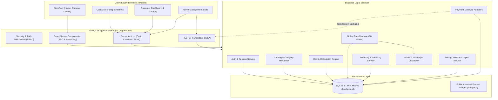
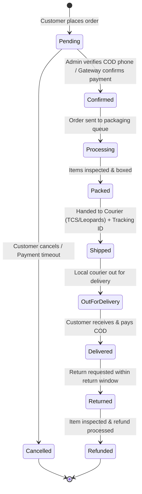

# Shawl Ghar (شال گھر) — Enterprise E-Commerce Platform
## Comprehensive Product Requirements Document (PRD) & System Architecture Specification

---

## 1. Executive Summary & Vision

**Shawl Ghar** is a premier Pakistani e-commerce platform specializing in authentic, handcrafted Kashmiri shawls, pashminas, pure wool stoles, and royal bridal wraps. Having successfully delivered Phase 1 (Foundation Prototype: visual identity, PKR currency, WhatsApp ordering, initial SQLite DB, and admin dashboard), this PRD outlines the architecture and execution blueprint for the **complete, production-grade 100% E-Commerce Platform**.

The platform provides:
1. **World-Class Customer Experience**: High-fashion aesthetic, instant search with suggestions, rich product galleries with zoom, dynamic variations (fabrics, sizes, embroidery styles), interactive cart, seamless multi-step checkout, real-time order tracking, wishlists, and verified reviews.
2. **Pakistani Localization**: Native PKR currency formatting, shipping rates tailored to Pakistani cities/regions, hybrid payment gateways (Cash on Delivery, JazzCash, Easypaisa, Bank Transfer, and Credit/Debit Cards via Stripe/PayMob), and automated WhatsApp notifications.
3. **Enterprise Administration Suite**: Centralized operational cockpit featuring real-time revenue analytics, comprehensive order lifecycle tracking, inventory movement audit logs, coupon campaigns, customer CRM, shipping zone calculators, and dynamic content management.

---

## 2. Technology Stack & Architectural Decision Records (ADRs)

### 2.1 Technology Matrix

| Layer | Selected Technology | Rationale |
|---|---|---|
| **Frontend Framework** | **Next.js 16 (App Router + Turbopack)** | Server Components (RSC) for lightning-fast initial load and SEO; client islands for interactive cart, filters, and checkout; streaming SSR for performance. |
| **Styling & UI** | **Tailwind CSS v4 + Lucide React** | Utility-first styling with zero-runtime CSS overhead, fluid responsive breakpoints, and consistent typography. |
| **Backend & APIs** | **Next.js Route Handlers + Server Actions** | Type-safe RPC-style mutations via Server Actions alongside standard RESTful JSON APIs for external integrations. |
| **Validation Layer** | **Zod Schema Validation** | Dual client-and-server data integrity verification for forms, carts, orders, and payment webhooks. |
| **Database Engine** | **SQLite (better-sqlite3, WAL Mode)** with PostgreSQL-ready schema | Zero-latency local storage, WAL mode for concurrent readers, transactional ACID guarantees. Schema strictly designed to allow one-click migration to PostgreSQL (Neon/Supabase/Render Postgres) if needed. |
| **Authentication & RBAC** | **HTTP-Only Secure Cookie Session + PBKDF2/Argon2** | Stateless/database-backed hybrid session tokens resistant to XSS and CSRF. Role-Based Access Control (`admin`, `staff_manager`, `customer`). |
| **State Management** | **React Context + Persistent LocalStorage + DB Sync** | Optimistic cart and wishlist updates with automatic synchronization upon customer authentication. |
| **Payments Integration** | **Modular Gateway Adapter Architecture** | Pluggable providers: Cash on Delivery (COD with phone verification), Bank Alfalah/Meezan Bank Transfer, JazzCash, Easypaisa, and Stripe. |
| **Deployment Target** | **Render.com + GitHub Automated CI/CD** | Automated builds from `nasirali786786/Shawltown` repository. |

---

## 3. System Architecture Diagram

---

## 4. Comprehensive Database Schema (28 Normalized Relational Tables)

The database schema is organized into 6 core domains: Identity, Catalog, Order & Cart, Inventory & Logistics, Financials & Promotions, and Audit.

### Domain 1: Identity & Access
1. `roles` (`id`, `name`, `description`, `created_at`)
2. `permissions` (`id`, `name`, `module`, `created_at`)
3. `role_permissions` (`role_id`, `permission_id`)
4. `users` (`id`, `role_id`, `name`, `email`, `password_hash`, `phone`, `status`, `last_login`, `created_at`, `updated_at`)
5. `customers` (`id`, `user_id`, `loyalty_points`, `notes`, `created_at`)
6. `customer_addresses` (`id`, `customer_id`, `address_type`, `recipient_name`, `phone`, `street_address`, `apartment`, `city`, `province`, `postal_code`, `is_default`, `created_at`)

### Domain 2: Product Catalog & Taxonomy
7. `categories` (`id`, `parent_id`, `name`, `slug`, `description`, `image_url`, `display_order`, `is_active`, `created_at`, `updated_at`)
8. `products` (`id`, `category_id`, `name`, `slug`, `sku`, `short_description`, `description`, `price`, `compare_at_price`, `cost_price`, `stock_quantity`, `low_stock_threshold`, `stock_status`, `is_featured`, `is_active`, `material`, `origin`, `dimensions`, `weight_grams`, `created_at`, `updated_at`)
9. `product_images` (`id`, `product_id`, `image_url`, `alt_text`, `display_order`, `is_primary`, `created_at`)
10. `product_attributes` (`id`, `name`, `slug`) — *e.g., Color, Fabric, Weave Type, Size*
11. `product_attribute_values` (`id`, `attribute_id`, `value`, `hex_color`)
12. `product_variations` (`id`, `product_id`, `sku`, `name`, `price_override`, `stock_quantity`, `image_url`, `is_active`, `created_at`)
13. `product_variation_values` (`variation_id`, `attribute_value_id`)

### Domain 3: Shopping Cart & Wishlist
14. `carts` (`id`, `customer_id`, `session_token`, `status`, `expires_at`, `created_at`, `updated_at`)
15. `cart_items` (`id`, `cart_id`, `product_id`, `variation_id`, `quantity`, `unit_price`, `created_at`, `updated_at`)
16. `wishlists` (`id`, `customer_id`, `product_id`, `created_at`)

### Domain 4: Orders & Order Lifecycle
17. `orders` (`id`, `order_number`, `customer_id`, `status`, `subtotal`, `discount_total`, `shipping_total`, `tax_total`, `grand_total`, `currency`, `shipping_method`, `payment_method`, `payment_status`, `tracking_number`, `notes`, `created_at`, `updated_at`)
18. `order_items` (`id`, `order_id`, `product_id`, `variation_id`, `product_name`, `sku`, `unit_price`, `quantity`, `total_price`)
19. `order_status_history` (`id`, `order_id`, `from_status`, `to_status`, `comment`, `changed_by_user_id`, `created_at`)

### Domain 5: Payments & Shipping Logistics
20. `payments` (`id`, `order_id`, `payment_method`, `amount`, `status`, `transaction_reference`, `gateway_response`, `created_at`)
21. `payment_transactions` (`id`, `payment_id`, `action`, `amount`, `status`, `raw_payload`, `created_at`)
22. `shipping_zones` (`id`, `name`, `provinces`, `cities`, `is_active`)
23. `shipping_rates` (`id`, `zone_id`, `min_order_subtotal`, `max_weight_grams`, `rate`, `estimated_days`)

### Domain 6: Inventory, Promotions, Reviews & Audit
24. `inventory_logs` (`id`, `product_id`, `variation_id`, `change_type`, `quantity_change`, `balance_after`, `reference_order_id`, `notes`, `created_at`)
25. `coupons` (`id`, `code`, `discount_type`, `discount_value`, `min_subtotal`, `max_discount_cap`, `start_date`, `end_date`, `usage_limit_total`, `usage_limit_per_user`, `times_used`, `is_active`, `created_at`)
26. `coupon_usages` (`id`, `coupon_id`, `order_id`, `customer_id`, `discount_amount`, `used_at`)
27. `reviews` (`id`, `product_id`, `customer_id`, `rating`, `title`, `comment`, `is_verified_purchase`, `status`, `created_at`)
28. `audit_logs` (`id`, `user_id`, `action`, `entity_type`, `entity_id`, `old_values`, `new_values`, `ip_address`, `created_at`)

---

## 5. Order State Machine Workflow

Orders progress through a strictly validated state transition pipeline to eliminate race conditions, double charging, and ghost inventory:

---

## 6. Security & Data Protection Specification

1. **Authentication Integrity**:
   - Customer and Admin sessions separated via role claims in signed HTTP-only cookies.
   - Brute-force protection on `/api/auth/login` (maximum 5 failed attempts per 15-minute sliding window).
   - Password security: Salted PBKDF2 with 10,000 rounds (or Argon2id) with minimum 8 characters, requiring mixed alphanumeric characters.
2. **API & Input Sanitization**:
   - Zero-trust input validation via Zod schemas on all API routes and Server Actions.
   - Parameterized SQL queries via `better-sqlite3` prepared statements to guarantee zero SQL injection risks.
   - HTML entity escaping and sanitization on all product descriptions and customer reviews to eliminate XSS risks.
3. **Transaction Safety**:
   - Inventory decrements wrapped in strict database transactions (`db.transaction`).
   - Optimistic concurrency checks to prevent overselling limited-edition artisanal shawls.
   - Cart prices verified against server-authoritative product records during checkout.
